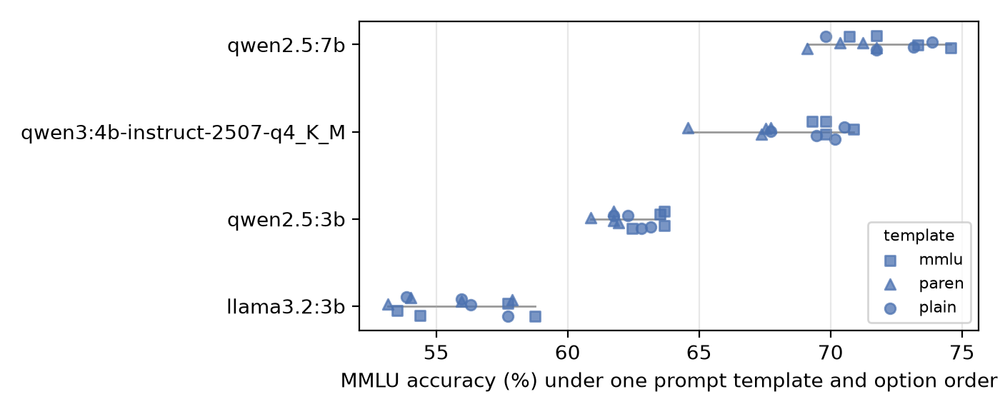
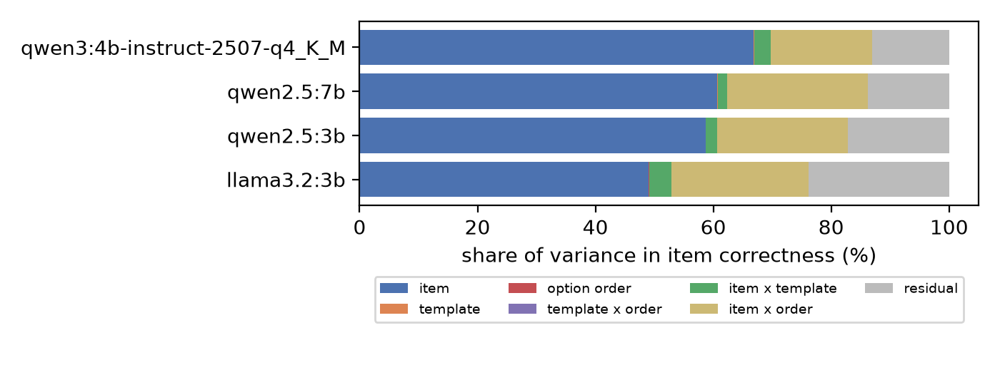
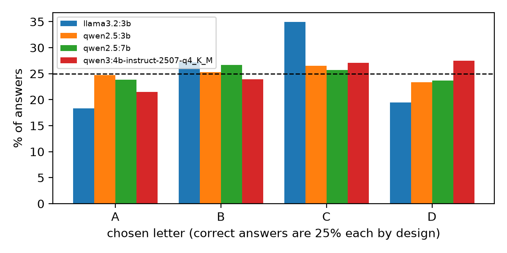

# llm-eval-reliability

**How reliable is an MMLU score?** This is a pre-registered generalizability-theory audit of four small open LLMs. It is also `evalrel`, a small tool that runs the same audit on any multiple-choice benchmark and any model served by Ollama.

Benchmark scores are usually reported from one run, with one prompt template and one option order. Psychometrics treats a score as an observation that contains measurement error. This project measures that error and turns it into a practical question: **how large does a difference between two models need to be before it is real?**

- Pre-registration: [`docs/PREREGISTRATION.md`](docs/PREREGISTRATION.md), frozen in commit `a1e207b` before data collection and registered on OSF
- Author: Muzamil (independent researcher)

## Design

| Facet | Levels |
|---|---|
| Items | 570 MMLU test items, 10 from each of the 57 subjects (seed 0) |
| Prompt template | `plain`, `mmlu` (the original paper's framing), `paren`; all end with the same answer instruction |
| Option order | 4 cyclic shifts, so the correct answer appears once at each of A–D |
| Retest | `plain` template, original order, temperature 0.7, seeds 1–3 |
| Models | llama3.2:3b, qwen2.5:3b, qwen2.5:7b, qwen3:4b-instruct-2507 (Ollama, greedy decoding, thinking off) |

The design produced 34,200 responses (570 items × 15 conditions × 4 models). A response that cannot be parsed counts as wrong.

## Results

### Accuracy across the 12 template × order conditions

| Model | Mean | SD | Min | Max | Range | Item-sampling SE (n = 570) |
|---|---|---|---|---|---|---|
| llama3.2:3b | 55.8 | 2.0 | 53.2 | 58.8 | 5.6 | 2.1 |
| qwen2.5:3b | 62.5 | 0.9 | 60.9 | 63.7 | 2.8 | 2.0 |
| qwen2.5:7b | 71.8 | 1.7 | 69.1 | 74.6 | 5.4 | 1.9 |
| qwen3:4b-instruct | 68.7 | 1.8 | 64.6 | 70.9 | 6.3 | 1.9 |



### Confirmatory hypotheses

| | Hypothesis | Result | Verdict |
|---|---|---|---|
| H1 | Accuracy differs across conditions for at least one model (Cochran's Q, Holm) | qwen3 Q(11) = 32.5, p_holm = .003; qwen2.5:7b Q = 25.0, p_holm = .027; llama p_holm = .062; qwen2.5:3b p_holm = .88 | **Supported** |
| H2 | At full MMLU size (14,042 items), format SEM > binomial item SE, for every model | SEM_format 1.6 / 0.8 / 1.6 / 1.8 pts vs item SE 0.38–0.42 pts (2–4.6× larger) | **Supported** |
| H3 | Chosen letters are not uniform for at least one model (χ², Holm) | All four p < .003; llama w = 0.27 (picks C 35%, A 18%), qwen3 w = 0.10, qwens w ≈ 0.05 | **Supported** |
| H4 | A pair whose difference CI includes 0 changes rank across conditions | No pair's 95% CI included 0, so the precondition never held | **Not supported** |

Exploratory note on H4: qwen2.5:7b beats qwen3-4b by 3.0 points overall (95% CI 0.6–5.6), but qwen3 wins under 1 of the 12 conditions. A pair that looks clearly separated on a single run can still swap places when only the format changes.

### Primary outcome: minimal detectable difference

MDD95 = 1.96 × √2 × SEM_format. This is the smallest difference between two scores that exceeds format noise with 95% confidence.

| Model | MDD95, 570 items | MDD95, full MMLU |
|---|---|---|
| llama3.2:3b | 6.0 pts | 4.4 pts |
| qwen2.5:3b | 4.2 pts | 2.3 pts |
| qwen2.5:7b | 5.4 pts | 4.4 pts |
| qwen3:4b-instruct | 5.8 pts | 4.9 pts |

**Takeaway:** for these models, an MMLU difference of less than about 2–5 points between two single-format runs is within format noise, even when all 14,042 items are used. Adding items does not remove this error, because it comes from template and order effects that are shared across items, not from item sampling.

### Variance components (G-study)



- Items account for 49–67% of the variance in item correctness.
- The **item × option order** interaction accounts for 17–24%. Whether a given item is answered correctly depends heavily on where its options appear.
- Template main effects are below 0.2%, and item × template is 1.5–3.8%.
- 32–59% of items change correctness under at least one condition. Only 44–68% of items get the same content answer under all four orders.

### Position bias



By design, each letter is correct 25% of the time. llama3.2:3b picks C 35% of the time and A 18%, and its accuracy is 70% when the answer is C but 48% when it is A.

### Exploratory analyses

- **Retest at T = 0.7** (Fleiss' κ over 3 seeds): llama 0.57, qwen2.5:3b 0.92, qwen2.5:7b 0.90, qwen3 0.95.
- **Parse rates:** 100% for the qwen2.5 models, 95–99% for llama, and 91–97% for qwen3 (lowest with the `paren` template).
- **Sensitivity (unparsed answers excluded):** accuracy changes by at most 4 points (qwen3 69 → 73), and the condition SD stays at 0.9–2.0 points.

### Deviations from the pre-registration

None in the design or the tests. The H2 item-sampling SE and the sensitivity analysis were computed with a short script outside `evalrel analyze`, using the formulas pre-registered.

### Limitations

- Four small, quantised models served by one runtime
- Zero-shot only, scored by letter parsing rather than log-probabilities
- Three templates are a narrow sample of possible prompt formats
- The template variance may be underestimated, because all three templates share the final instruction

## Using `evalrel`

```bash
python -m venv .venv && .venv/bin/pip install -e ".[mmlu,dev]"
ollama pull qwen2.5:3b
.venv/bin/evalrel sample                       # draw the 570-item stratified sample
.venv/bin/evalrel run --models qwen2.5:3b      # resumable; writes results/main/<model>.csv
.venv/bin/evalrel analyze results/main         # tables, analysis.json, figures
```

To change the items, models, templates, orders or retest settings, edit `configs/design.yaml`. Tests: `.venv/bin/pytest`.

## References

- Brennan, R. L. (2001). *Generalizability Theory*. Springer.
- Hendrycks, D., et al. (2021). Measuring massive multitask language understanding. *ICLR*.
- Pezeshkpour, P., & Hruschka, E. (2024). Large language models sensitivity to the order of options in multiple-choice questions. *Findings of NAACL*.
- Sclar, M., et al. (2024). Quantifying language models' sensitivity to spurious features in prompt design. *ICLR*.
- Weir, J. P. (2005). Quantifying test-retest reliability using the ICC and the SEM. *J. Strength Cond. Res.*, 19(1).
- Zheng, C., et al. (2024). Large language models are not robust multiple choice selectors. *ICLR*.

## License

MIT
