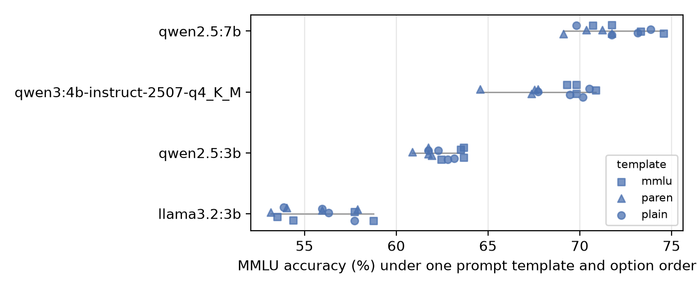
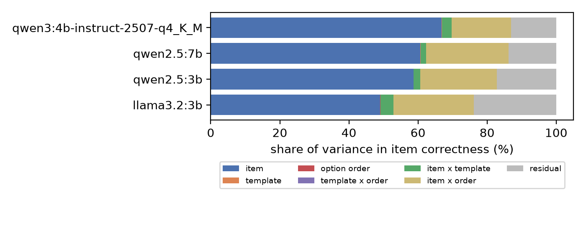
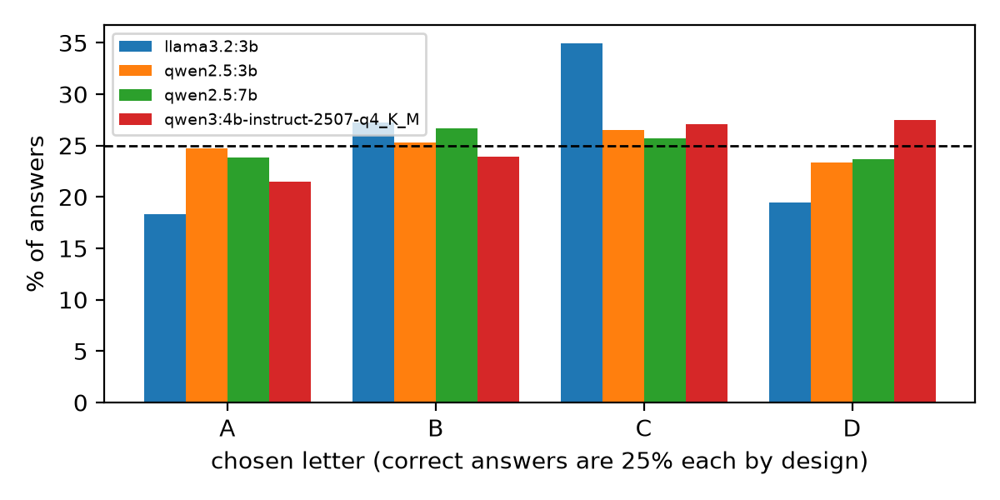

# 1. Introduction

LLMs are compared and ranked mainly by their scores on benchmarks such as MMLU (Hendrycks et al., 2021). A typical report gives one number per model, computed with one prompt template and one fixed order of the answer options. When an uncertainty estimate is given at all, it is usually the binomial standard error over items, which treats the items as the only source of error.

Psychometrics has a different starting point. An observed score is a measurement, and a measurement contains error from every aspect of the procedure that could have been otherwise (Brennan, 2001). For a multiple-choice benchmark, the order of the options and the layout of the prompt are such aspects. A test-taker who knows the answer should not care whether it is listed as A or as D, or whether the options are written "A." or "(A)". If scores change with these choices, part of what a benchmark measures is the format, not the ability.

The fact that LLM scores are sensitive to option order and prompt format is not new. Models prefer particular answer letters (Zheng et al., 2024; Pezeshkpour & Hruschka, 2024), small changes in prompt formatting can move accuracy by many points (Sclar et al., 2024), and such perturbations can reorder leaderboards (Alzahrani et al., 2024). What is missing is a way to turn these findings into the quantities a psychometrician would report: how much of the score variance each source contributes, the standard error of measurement (SEM) that results, and the smallest difference between two scores that can be trusted.

This study provides those quantities for MMLU and four small open models. Generalizability theory (G-theory) is the natural framework, because it treats the item, the template and the option order as random facets of one fully crossed design and estimates their variance components together. I asked:

1. Does accuracy depend on the template and option order (H1)?
2. Is the error due to format larger than the item-sampling error that is usually reported, even at the full size of the benchmark (H2)?
3. Do models prefer some answer letters when correct answers are balanced (H3)?
4. Do models whose overall difference is uncertain change rank across formats (H4)?

The primary outcome was the minimal detectable difference (MDD) between two models' scores. The hypotheses, design and analyses were pre-registered before the main data were collected.

# 2. Methods

## 2.1 Pre-registration

The design file, analysis code and pre-registration document were frozen in a public commit before the main run (commit `a1e207b` of the code repository) and registered on the Open Science Framework. A 40-item pilot with all four models was used only to check the pipeline and the time cost, and its data are not analysed. The pilot showed one problem. With the original MMLU framing, which ends in "Answer:" with no instruction, models often wrote sentences instead of letters, so up to 100% of responses could not be scored. All templates were therefore given the same final instruction before registration.

## 2.2 Models

I tested llama3.2:3b, qwen2.5:3b, qwen2.5:7b and qwen3:4b-instruct-2507 (4-bit quantised, q4_K_M). All were run locally with Ollama 0.40.16 in chat mode, with reasoning ("thinking") disabled and a limit of 8 generated tokens. Facet conditions used greedy decoding (temperature 0).

## 2.3 Items

I drew 570 items from the MMLU test set, 10 at random from each of its 57 subjects (seed 0). Stratifying by subject keeps the sample's composition close to the full test of 14,042 items.

## 2.4 Design

The facet arm crossed every item with 3 templates and 4 option orders, giving 12 conditions per item.

- **Templates.** `plain` lists the question and the options as "A. …". `mmlu` adds the original paper's framing, "The following is a multiple choice question about {subject}." `paren` labels the question and lists the options as "(A) …". All three end with "Answer with the letter of the correct option only." The templates differ in layout and framing, not in what is asked.
- **Option orders.** Four cyclic shifts of the original options were used. Each item's correct answer therefore appears exactly once in each position A–D, so correct answers are uniform over letters by construction.

The retest arm used the `plain` template with the original option order at temperature 0.7, with seeds 1–3, to estimate sampling stability.

**Scoring.** A deliberately strict parser took the first clearly stated letter A–D: at the start of the response, after "answer is", or in parentheses. A bare "A" opening a sentence ("A cell is…") was not counted. Responses that could not be parsed were scored as wrong. Each model gave 8,550 responses, so there were 34,200 in total.

## 2.5 Analysis

**G-study.** For each model, I fitted a random-effects G-study to the 0/1 correctness scores in the fully crossed items (*i*) × templates (*t*) × orders (*r*) design, with one observation per cell. Variance components were estimated from the expected mean squares, and negative estimates were set to 0 (Brennan, 2001). Components are reported as shares of the total variance.

**SEM due to format.** The standard error of a model's accuracy across arbitrary formats, for a test of *n* items, is

SEM~format~ = √(σ²~t~ + σ²~r~ + σ²~tr~ + (σ²~it~ + σ²~ir~ + σ²~itr,e~) / *n*).

The first three terms do not shrink as *n* grows: a template or option order that helps the model helps it on every item. SEM~format~ was computed at *n* = 570 and extrapolated to *n* = 14,042.

**MDD.** The minimal detectable difference between two scores at 95% confidence is MDD~95~ = 1.96 × √2 × SEM~format~ (Weir, 2005).

**Tests.**

- H1: Cochran's Q across the 12 conditions, per model.
- H2: SEM~format~ compared with the binomial item-sampling error √(*p*(1 − *p*)/*n*) at *n* = 14,042, per model.
- H3: χ² goodness of fit of the chosen letters against a uniform distribution, with effect size *w* = √(χ²/*N*).
- H4: For each pair of models, a paired item bootstrap (2,000 resamples) of the overall difference, and a count of the conditions in which each model ranked higher.

H1 and H3 were Holm-corrected across the four models, with α = .05.

**Exploratory analyses**, labelled as such:

- The share of items that change correctness across conditions
- Whether the same option content was chosen under all four orders
- Fleiss' κ across the three retest runs
- Parse rates
- A sensitivity analysis that excludes unparsed responses

# 3. Results

## 3.1 Accuracy depends on format (H1)

: Table 1. Accuracy (%) over the 12 template × option-order conditions, and Cochran's Q test of equality (df = 11). The item-sampling SE is the binomial standard error of one condition at *n* = 570.

| Model | Mean | SD | Min | Max | Range | Item-sampling SE | Q | *p*~Holm~ |
|---|---|---|---|---|---|---|---|---|
| llama3.2:3b | 55.8 | 2.0 | 53.2 | 58.8 | 5.6 | 2.1 | 21.2 | .062 |
| qwen2.5:3b | 62.5 | 0.9 | 60.9 | 63.7 | 2.8 | 2.0 | 6.0 | .876 |
| qwen2.5:7b | 71.8 | 1.7 | 69.1 | 74.6 | 5.4 | 1.9 | 25.0 | .027 |
| qwen3:4b-instruct | 68.7 | 1.8 | 64.6 | 70.9 | 6.3 | 1.9 | 32.5 | .003 |

Accuracy differed significantly across conditions for qwen3:4b-instruct and qwen2.5:7b, so H1 was supported (Table 1, Figure 1). For three of the four models, the best and worst condition differed by more than 5 points. qwen2.5:3b was the exception: its accuracy varied by less than 3 points and its test was far from significant.

{width=60%}

## 3.2 Format error does not average out (H2)

{width=60%}

: Table 2. G-study variance components (% of total), standard error of measurement due to format, and minimal detectable difference (percentage points). Columns: *i* = item, *ir* = item × order, *it* = item × template, *t* = template, *r* = order, *itr,e* = residual. Full = extrapolated to all 14,042 MMLU test items.

| Model | *i* | *ir* | *it* | *t* | *r* | *itr,e* | SEM~570~ | SEM~full~ | Item SE~full~ | MDD~570~ | MDD~full~ |
|---|---|---|---|---|---|---|---|---|---|---|---|
| llama3.2:3b | 49.1 | 23.3 | 3.8 | 0.0 | 0.1 | 23.8 | 2.2 | 1.6 | 0.42 | 6.0 | 4.4 |
| qwen2.5:3b | 58.7 | 22.2 | 2.0 | 0.0 | 0.0 | 17.1 | 1.5 | 0.8 | 0.41 | 4.2 | 2.3 |
| qwen2.5:7b | 60.7 | 23.9 | 1.5 | 0.0 | 0.1 | 13.8 | 2.0 | 1.6 | 0.38 | 5.4 | 4.4 |
| qwen3:4b-instruct | 66.8 | 17.3 | 2.8 | 0.1 | 0.0 | 13.0 | 2.1 | 1.8 | 0.39 | 5.8 | 4.9 |

Items were the largest source of variance (49–67%), as they should be for a test that discriminates between easy and hard questions (Table 2, Figure 2). The second largest source was the **item × option order** interaction (17–24%). Whether a model answered a particular item correctly depended strongly on where that item's options were placed, and the direction of this effect differed from item to item. Template effects were small: the main effect was at most 0.1% and item × template was 1.5–3.8%. The template × order interaction was essentially 0 for all models.

The template and order main effects were small as shares of variance, but they matter most at scale, because they do not shrink as items are added. At the full size of MMLU, SEM~format~ was 0.8 to 1.8 points. This is 2.0 to 4.6 times the binomial item-sampling error (0.38–0.42 points), so H2 was supported for every model. A confidence interval based on items alone understates the uncertainty of a full-MMLU score by that factor.

The minimal detectable difference between two single-format runs was 4.2 to 6.0 points on the 570-item sample and 2.3 to 4.9 points on the full test.

## 3.3 Models prefer answer letters (H3)

{width=50%}

Every model's choices departed from the uniform distribution guaranteed by the design (all *p*~Holm~ < .003), so H3 was supported (Figure 3). The effect was large for llama3.2:3b (*w* = 0.27). It chose C on 35.0% of trials and A on only 18.3%, and its accuracy was 70.4% when the correct answer was in position C but 47.9% when it was in position A. qwen3:4b-instruct preferred the later letters C and D (*w* = 0.10), and its accuracy ranged from 67.1% (answer at A) to 76.7% (answer at C). The two qwen2.5 models showed only small biases (*w* ≈ 0.05).

## 3.4 Rankings (H4)

All six pairs of models had overall differences whose 95% bootstrap confidence interval excluded 0. The pre-registered condition for H4 (a pair whose interval includes 0) was therefore never met, and H4 was not supported. Five pairs kept the same order in all 12 conditions.

The sixth pair is informative as an exploratory observation. qwen2.5:7b outscored qwen3:4b-instruct by 3.0 points overall (95% CI 0.6 to 5.6). This difference would be called significant in a standard report, yet qwen3:4b-instruct ranked higher in 1 of the 12 conditions, where the difference ranged from −0.7 to +5.8 points. A difference of this size lies within the MDD from section 3.2.

## 3.5 Exploratory analyses

**Item-level instability.** Under at least one of the 12 conditions, 32% (qwen3:4b-instruct) to 59% (llama3.2:3b) of items changed from correct to incorrect or back. The same option content was chosen under all four orders for only 44% to 68% of items.

**Retest.** With sampling at temperature 0.7, the three qwen models were stable (Fleiss' κ = 0.90–0.95), but llama3.2:3b was not (κ = 0.57; all three runs agreed on 51% of items).

**Parsing.** The qwen2.5 models produced a scorable letter on 99.8–100% of trials. llama3.2:3b did so on 95–99% and qwen3:4b-instruct on 91–97%, with the lowest rate under the `paren` template.

**Sensitivity analysis.** Excluding unparsed responses raised qwen3's accuracy from 68.7% to 72.8% and llama3.2's from 55.8% to 57.6%. The standard deviation across conditions remained between 0.9 and 2.0 points, so the conclusions do not depend on how unparsed responses were scored.

# 4. Discussion

A single MMLU score from one template and one option order is a noisy measurement, and the usual confidence interval hides most of the noise. For the four models studied, the error introduced by arbitrary formatting choices was two to five times larger than the item-sampling error at the full benchmark size. Two scores from single-format runs need to differ by roughly 2 to 5 points before the difference exceeds format noise.

G-theory explains why more items do not solve the problem. Most of the format-related variance is an interaction with items: a given option order helps on some items and hurts on others, and this part does average out over many items. What remains is the smaller set of main effects, a template or an order that shifts every item in the same direction. These effects are a fraction of a percent of the variance, but they do not shrink with *n*, so at 14,042 items they dominate the error. The usual binomial standard error, which falls as 1/√*n*, is the wrong error model for a test whose format was fixed once.

The size of the item × order component (17–24%) also says something about the models as test-takers. A human who knows an answer finds it wherever it is listed. For these models, a substantial fraction of correct answers on individual items depend on position, and for llama3.2:3b a strong preference for C means that its score partly reflects how often the answer happens to be C. Counterbalancing the option order, as done here, removes this bias from the mean score but not from the variance.

The models differed considerably in reliability. qwen2.5:3b was the most format-robust (MDD 2.3 points at full size) despite being one of the smaller models, while qwen3:4b-instruct had higher accuracy but the largest format error. Reliability is therefore a property worth reporting alongside accuracy, not something that comes automatically with performance.

**Recommendations.** These follow from the analysis and match standard psychometric practice.

1. Report scores averaged over several option orders, preferably all cyclic shifts, and several templates.
2. Report the spread across those conditions together with the mean.
3. Treat differences smaller than the MDD as unresolved.

The `evalrel` tool produces all of these from one command.

# 5. Limitations

**Models and setup.** Only four small, quantised models were tested, through one runtime, zero-shot, and scored by parsing a generated letter rather than comparing log-probabilities. Larger models may be more robust, and log-probability scoring removes parsing failures, though it does not remove position bias (Zheng et al., 2024).

**Templates.** Three templates are a narrow sample of the formats in use. Because all three end with the same instruction, the template variance is probably an underestimate, and the format SEM is better read as a lower bound.

**Scope of the extrapolation.** The full-size estimates assume that the variance components from 570 items hold for the whole test.

**H4.** The rank-flip hypothesis was conditioned on pairs with uncertain differences, which these four well-separated models did not provide. A test with more models of similar ability would be more informative.

# Data and code availability

All code, prompts, raw responses, analysis outputs and figures are available at https://github.com/Muzz698/llm-eval-reliability. The pre-registration is in `docs/PREREGISTRATION.md` (frozen at commit `a1e207b`) and on the Open Science Framework. The repository includes automated tests, and every result can be reproduced on a laptop with free software.

# Author contributions and use of AI tools

Muzamil conceived the study, chose the psychometric framing and the benchmark, decided which facets to vary, pre-registered the hypotheses, ran all experiments on local hardware, checked the results against the raw data, and wrote and approved the final manuscript. An AI assistant (Claude, Anthropic) was used as a programming and writing tool, to implement analysis code to the author's specification and to edit the text. All scientific decisions and interpretations are the author's, and the author takes full responsibility for the content.

# References

Alzahrani, N., Alyahya, H. A., Alnumay, Y., et al. (2024). When benchmarks are targets: Revealing the sensitivity of large language model leaderboards. *Proceedings of the 62nd Annual Meeting of the Association for Computational Linguistics*.

Brennan, R. L. (2001). *Generalizability theory*. Springer.

Hendrycks, D., Burns, C., Basart, S., Zou, A., Mazeika, M., Song, D., & Steinhardt, J. (2021). Measuring massive multitask language understanding. *International Conference on Learning Representations*.

Pezeshkpour, P., & Hruschka, E. (2024). Large language models sensitivity to the order of options in multiple-choice questions. *Findings of the Association for Computational Linguistics: NAACL 2024*.

Sclar, M., Choi, Y., Tsvetkov, Y., & Suhr, A. (2024). Quantifying language models' sensitivity to spurious features in prompt design. *International Conference on Learning Representations*.

Weir, J. P. (2005). Quantifying test-retest reliability using the intraclass correlation coefficient and the SEM. *Journal of Strength and Conditioning Research, 19*(1), 231–240.

Zheng, C., Zhou, H., Meng, F., Zhou, J., & Huang, M. (2024). Large language models are not robust multiple choice selectors. *International Conference on Learning Representations*.
